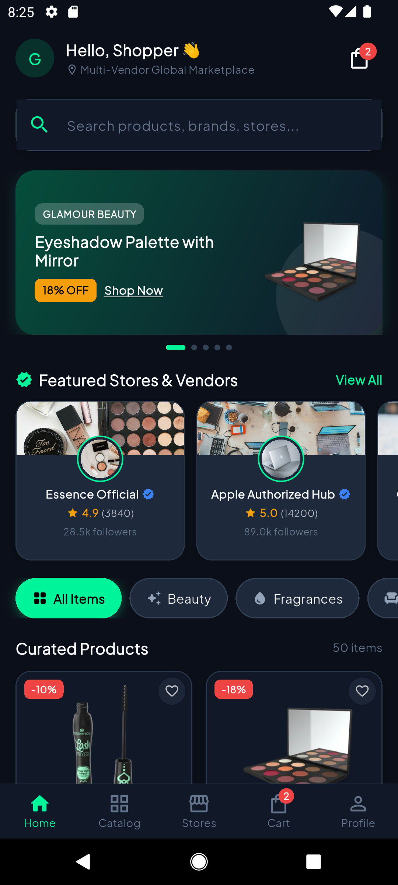
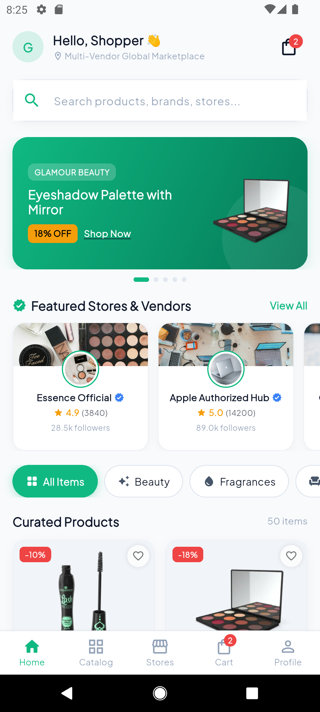
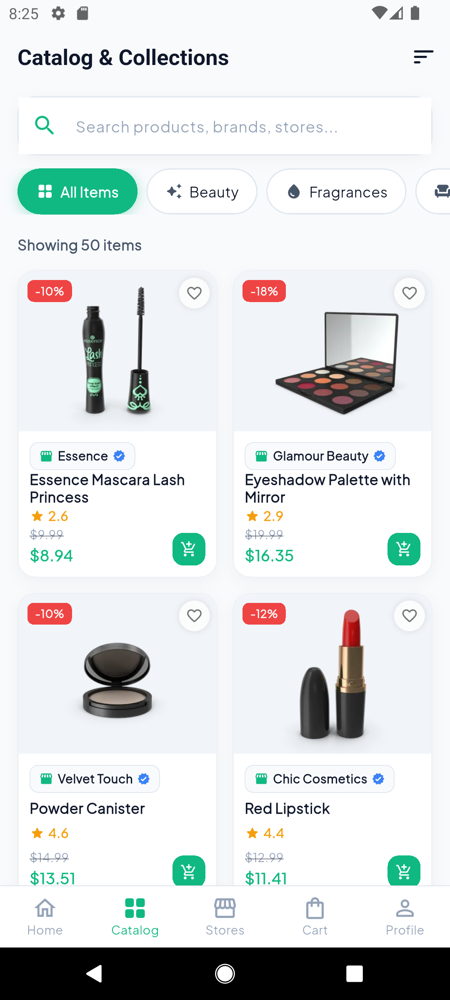
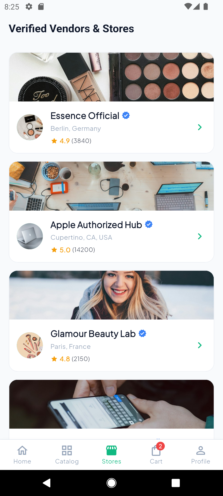
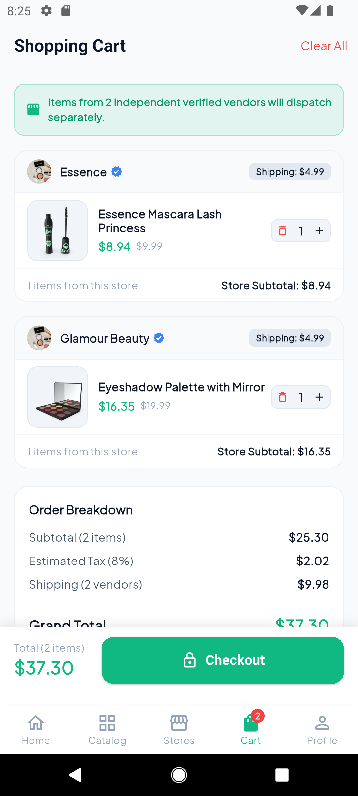
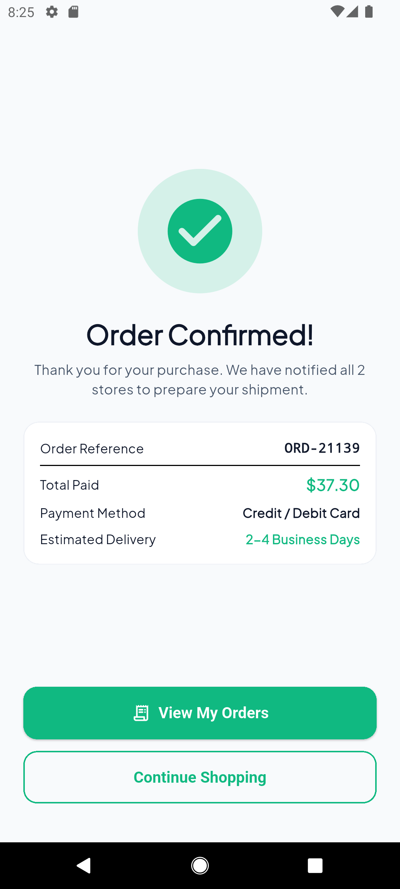

# Multi-Vendor E-Commerce App

[](https://flutter.dev)
[](https://dart.dev)
[-10B981?style=for-the-badge)](https://blog.cleancoder.com)
[](https://bloclibrary.dev)
[](https://github.com/a7mdabdoo/multi-vendor-ecommerce-app/releases/latest)

A production-grade, enterprise-architected Flutter application designed from the ground up as a premier portfolio project showcasing **Feature-First Clean Architecture**, state management via **BLoC**, declarative routing with **GoRouter**, resilient networking via **Dio**, and **Multi-Vendor Marketplace** orchestration.

---

## Application Screenshots

| 1. Home (Dark Mode) | 2. Home (Light Mode) | 3. Catalog & Search |
|:---:|:---:|:---:|
|  |  |  |

| 4. Vendors Directory | 5. Multi-Vendor Cart | 6. Order Confirmation |
|:---:|:---:|:---:|
|  |  |  |

---

## Key Highlights & Architecture Principles

- **Strict Clean Architecture (Feature-First):** Clear separation into `domain`, `data`, and `presentation` layers for every core business domain.
- **Dynamic Multi-Vendor Capabilities:**
  - Real-time aggregation of catalog items by independent verified merchants & brands.
  - Dedicated **Vendor Storefront Pages** with verified seller badges, custom banners, ratings, follower metrics, and vendor-exclusive catalogs.
  - **Vendor-Grouped Cart Management:** Cart items dynamically group under their respective vendor headers with per-store subtotal and free shipping thresholds.
  - Transparent checkout simulation breaking down multi-store dispatch and tax estimations.
- **Robust Networking with Dio:** Centralized `DioClient` with custom interceptors (`AuthInterceptor`, `LoggingInterceptor`), dynamic timeout configuration, and unified error mapping to domain `Failures`.
- **Predictable State Management:** `flutter_bloc` and `equatable` throughout the application for unidirectional data flow and testability.
- **Dependency Injection:** Powered by `get_it` Service Locator in a centralized `injection_container.dart`.
- **Theme & Design System:** Luxurious dual-mode theming (**Dark Obsidian & Neon Emerald** / **Clean Light Material 3**) with responsive Google Fonts typography, shimmer loading skeletons, and interactive state feedback.
- **Recruiter Fast-Pass:** One-click instant **Demo Account Login** (`emilys` / `emilyspassword`) for rapid reviewer onboarding.

---

## Clean Architecture & Data Flow

```mermaid
flowchart TD
    subgraph Presentation Layer
        UI["Widgets & Pages\n(Home, Catalog, Storefront, Cart, Checkout)"]
        BLOC["BLoC / Cubit\n(Events & States)"]
        UI -->|Dispatches Events| BLOC
        BLOC -->|Emits States| UI
    end

    subgraph Domain Layer (Pure Dart)
        UC["UseCases\n(GetProducts, AddToCart, PlaceOrder, etc.)"]
        ENT["Entities\n(Product, Vendor, Cart, Order, User)"]
        REP_INT["Abstract Repository Interfaces\n(ProductRepository, AuthRepository, etc.)"]
        BLOC -->|Invokes| UC
        UC -->|Calls| REP_INT
        UC -->|Returns| ENT
    end

    subgraph Data Layer
        REP_IMPL["Repository Implementations\n(ProductRepositoryImpl, etc.)"]
        MODELS["Data Models (JSON Serialization)\n(ProductModel, VendorModel, etc.)"]
        REMOTE_DS["Remote DataSources\n(Dio HTTP Client to DummyJSON)"]
        LOCAL_DS["Local DataSources\n(SharedPreferences Caching)"]

        REP_INT -.->|Implemented by| REP_IMPL
        REP_IMPL -->|Fetches / Deserializes| MODELS
        REP_IMPL -->|Queries| REMOTE_DS
        REP_IMPL -->|Caches| LOCAL_DS
    end
```

---

## Project Folder Structure

```
lib/
├── core/
│   ├── constants/
│   │   ├── api_constants.dart          # Base URL, endpoints, timeouts
│   │   ├── app_colors.dart             # Dark Obsidian & Light Emerald palette
│   │   └── app_constants.dart          # Demo credentials, tax rates, keys
│   ├── error/
│   │   ├── exceptions.dart             # Server, Cache, Network & Auth exceptions
│   │   └── failures.dart               # Domain failure abstractions (Equatable)
│   ├── network/
│   │   ├── dio_client.dart             # Centralized Dio wrapper with error handlers
│   │   └── interceptors/
│   │       ├── auth_interceptor.dart   # Automatic Bearer token injection
│   │       └── logging_interceptor.dart# Detailed HTTP traffic inspection
│   ├── services/
│   │   └── storage_service.dart        # SharedPreferences wrapper (Token, Cart, Orders)
│   ├── theme/
│   │   ├── app_theme.dart              # Material 3 light & dark themes
│   │   └── theme_cubit.dart            # Dynamic theme mode manager & persistence
│   ├── utils/
│   │   ├── currency_formatter.dart     # Consistent currency formatting
│   │   └── debouncer.dart              # Search debounce utility
│   └── widgets/
│       ├── custom_button.dart          # Loading, outlined, and icon-supported button
│       ├── custom_text_field.dart      # Styled form field with validation
│       ├── empty_view.dart             # Universal empty state component
│       ├── error_view.dart             # Retryable error presentation
│       ├── loading_shimmer.dart        # Smooth skeleton shimmer loading grids
│       ├── rating_badge.dart           # Gold star rating badge
│       └── vendor_badge.dart           # Store pill with verified checkmark
├── features/
│   ├── auth/                           # Authentication & Demo login
│   │   ├── domain/ (entities, repositories, usecases)
│   │   ├── data/ (models, datasources, repositories)
│   │   └── presentation/ (bloc, pages, widgets)
│   ├── vendors/                        # Multi-Vendor Storefront & Directory
│   │   ├── domain/ (vendor_entity, vendor_repository, usecases)
│   │   ├── data/ (vendor_model, remote_datasource, repository_impl)
│   │   └── presentation/ (vendor_bloc, storefront_page, directory_page)
│   ├── products/                       # Catalog, Categories & Product Details
│   │   ├── domain/ (product_entity, category_entity, usecases)
│   │   ├── data/ (product_model, category_model, remote_datasource)
│   │   └── presentation/ (products_bloc, home_page, catalog_page, details_page)
│   ├── cart/                           # Multi-Vendor dynamic cart grouping
│   │   ├── domain/ (cart_item_entity, vendor_cart_group, cart_entity, usecases)
│   │   ├── data/ (cart_item_model, local_datasource, repository_impl)
│   │   └── presentation/ (cart_bloc, cart_page, checkout_page, widgets)
│   ├── orders/                         # Checkout orders & order history
│   │   ├── domain/ (order_entity, order_repository, usecases)
│   │   ├── data/ (order_model, local_datasource, repository_impl)
│   │   └── presentation/ (order_bloc, orders_page, order_success_page)
│   ├── wishlist/                       # Favorites bookmarking
│   │   └── presentation/ (wishlist_cubit, wishlist_page)
│   ├── profile/                        # Account profile & settings
│   │   └── presentation/ (profile_page)
│   └── navigation/
│       └── presentation/ (main_layout_screen)
├── routes/
│   └── app_router.dart                 # Declarative GoRouter configuration
├── injection_container.dart            # GetIt service locator setup
└── main.dart                           # MultiBlocProvider bootstrap & app runner
```

---

## Core Features Walkthrough

### 1. Authentication Flow
- **Form Validation:** Client-side validation for username/email and passwords.
- **REST Integration:** Authenticates against DummyJSON `/auth/login`.
- **One-Click Demo Login:** Dedicated Recruiter Fast-Pass button for immediate evaluation.

### 2. Home & Multi-Vendor Catalog
- **Advanced Live Search:** Debounced instant search filtering products and merchants simultaneously.
- **Category Filter Rail:** Interactive horizontal chips (`Beauty`, `Fragrances`, `Laptops`, `Phones`, `Fashion`, etc.).
- **Featured Vendors Rail:** Displays verified marketplace merchants; tapping any store navigates to its **Vendor Storefront**.
- **Promotional Deals Carousel:** Highlights products with heavy discounts and flash sale tags.

### 3. Vendor Storefront
- High-resolution store banner, official avatar, location, and verified merchant pill.
- Store performance metrics: star rating, review counter, and follower count with interactive "Follow" toggle.
- **Store-Exclusive Products Grid:** Displays only products sold and dispatched by this specific merchant.

### 4. Dynamic Multi-Vendor Cart
- Add/remove items and adjust quantities on the fly with animated feedback.
- **Grouped by Vendor:** Items in the cart automatically group into vendor cards, illustrating real-world multi-seller commerce.
- Free shipping calculation per vendor (orders above \$50 qualify for free delivery).
- Comprehensive breakdown: Subtotal, 8% Estimated Tax, Multi-Vendor Shipping Fees, and Grand Total.

### 5. Checkout & Orders History
- Checkout form with address input, shipping speed, and payment method selector.
- Order confirmation receipt with reference number (`ORD-XXXXX`) and estimated arrival dates.
- Persistent order history page preserved across sessions.

### 6. Dark / Light Mode
- Obsidian dark theme with neon emerald accents.
- Seamless live switching saved in local storage.

---

## Tech Stack & Packages

| Package | Purpose |
|---|---|
| `flutter_bloc` | Unidirectional state management |
| `equatable` | Value equality for state and events |
| `dio` | HTTP networking with interceptors & centralized errors |
| `get_it` | Dependency injection & service locator |
| `go_router` | Declarative routing with typed arguments |
| `shared_preferences` | Local persistence (Auth tokens, Cart, Orders, Theme) |
| `cached_network_image` | Image caching with placeholders and error widgets |
| `shimmer` | Skeleton shimmer loading states |
| `google_fonts` | Modern Plus Jakarta Sans typography |
| `intl` | Currency and date formatting |

---

## Quick Start Guide

### Prerequisites
- Flutter SDK `^3.47.0` or higher
- Dart SDK `^3.13.0` or higher

### Steps to Run
```bash
# 1. Clone or navigate to the project directory
cd multi_vendor_ecommerce

# 2. Get dependencies
flutter pub get

# 3. Verify static analysis (Zero issues!)
flutter analyze

# 4. Run test suite
flutter test

# 5. Launch the application
flutter run
```

---

## Testing

The project includes unit and domain calculation tests verifying:
- Discounted price logic on `ProductEntity`.
- Per-vendor cart grouping and free shipping calculation on `CartEntity`.

To execute:
```bash
flutter test
```
Result:
```
00:00 +0: Multi-Vendor Domain & Cart Calculation Tests ProductEntity calculated discounted price correctly
00:00 +1: Multi-Vendor Domain & Cart Calculation Tests CartEntity correctly groups items by separate vendors
00:00 +2: All tests passed!
```
